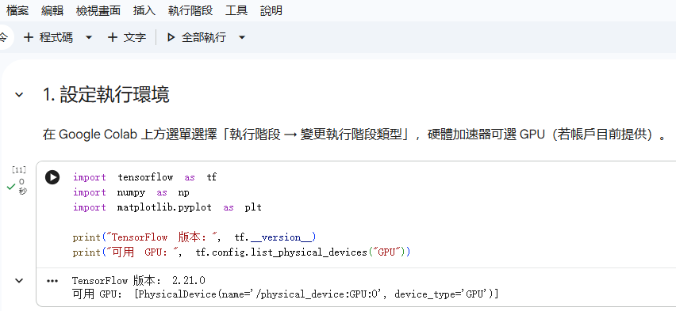
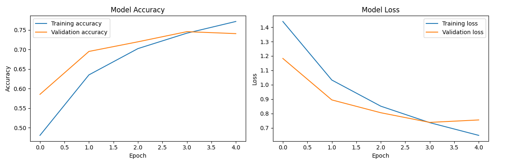
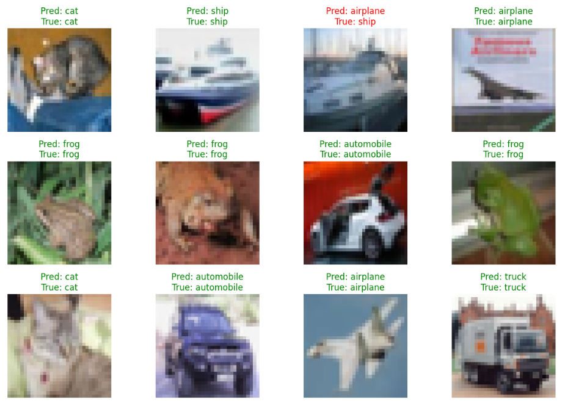

# AI 圖片分類專案：使用 CNN 分類 CIFAR-10 圖片

# 組員
  11424239 陳禹睿

## 一、專案簡介
本專案示範如何使用 **Google Colaboratory（Google Colab）** 雲端環境執行 AI 圖片分類。透過 Python、TensorFlow/Keras 建立卷積神經網路（CNN），讓模型辨識 CIFAR-10 資料集中的圖片類別。

本專案依照課程指定文章所介紹的 Colab 專案流程進行：在 Colab 建立並執行程式、保存 `.ipynb` 筆記本、編寫 `README.md`，最後將檔案上傳至 GitHub。

## 二、專案目的
1. 熟悉 Google Colab 雲端 Python 執行環境。
2. 了解 AI 圖片分類的基本流程。
3. 使用 TensorFlow/Keras 建立 CNN 模型。
4. 完成模型訓練、測試與預測結果展示。
5. 練習將 Colab 專案整理並上傳至 GitHub。

## 三、使用工具與技術
| 工具／技術 | 用途 |
|---|---|
| Google Colab | 雲端執行 Python 程式 |
| Python | 專案主要程式語言 |
| TensorFlow / Keras | 建立及訓練 CNN 模型 |
| CIFAR-10 | 圖片分類資料集 |
| NumPy | 數值及陣列處理 |
| Matplotlib | 顯示圖片與訓練曲線 |
| GitHub | 專案版本保存與分享 |

## 四、資料集介紹
本專案使用 CIFAR-10 公開資料集，包含 10 種圖片類別：
- airplane（飛機）
- automobile（汽車）
- bird（鳥）
- cat（貓）
- deer（鹿）
- dog（狗）
- frog（青蛙）
- horse（馬）
- ship（船）
- truck（卡車）

資料集包含 50,000 張訓練圖片及 10,000 張測試圖片，圖片大小為 32 × 32 像素、RGB 三個色彩通道。

## 五、Google Colab 執行流程
1. 開啟 [Google Colab](https://colab.research.google.com/)。
2. 選擇「新增筆記本」。
3. 上傳本專案的 `AI_Project.ipynb`，或將它放入 Google Drive 後以 Colab 開啟。
4. 在「執行階段」設定中，視帳戶可用資源選擇 GPU；沒有 GPU 時仍可使用 CPU 執行。
5. 依序執行筆記本中的程式碼儲存格。
6. 等待 CIFAR-10 資料集下載及模型訓練完成。
7. 檢查訓練曲線、測試準確率與圖片預測結果。
8. 使用「檔案 → 下載 → 下載 .ipynb」保存完成的筆記本。

## 六、模型流程
1. 載入 CIFAR-10 訓練集與測試集。
2. 將圖片像素值正規化至 0～1。
3. 建立 CNN：卷積層、池化層、Dropout 與全連接層。
4. 使用 Adam optimizer 與 sparse categorical crossentropy 訓練模型。
5. 以測試集評估模型。
6. 顯示測試圖片的預測類別與實際類別。

## 七、執行結果與截圖

### 1. Colab 執行環境


### 2. 模型訓練結果與準確率曲線


### 3. 圖片分類預測結果



## 八、專案檔案
```text
AI_Project/
├── README.md
├── AI_Project.ipynb
└── images/
    ├── colab_environment.png
    ├── training_result.png
    └── detection_result.png
```

## 九、結論與心得
透過本次實作，我了解如何使用 Google Colab 建立雲端 AI 開發環境，並運用 TensorFlow/Keras 建立 CNN 圖片分類模型。從資料集載入、資料預處理、模型訓練到測試與預測，完成了基本的 AI 圖片分類流程，也學習如何將程式筆記本與專案說明文件整理後上傳至 GitHub。

本範例為入門教學，模型效果仍可透過增加訓練次數、資料增強及調整模型架構進一步改善。

## 十、參考資料
1. 課程指定文章：[Colab跑项目_colab运行自己的项目](https://blog.csdn.net/qq_51070956/article/details/134503497)
2. Google Colab：https://colab.research.google.com/
3. TensorFlow CNN 教學：https://www.tensorflow.org/tutorials/images/cnn
4. CIFAR-10 資料集：https://www.cs.toronto.edu/~kriz/cifar.html
